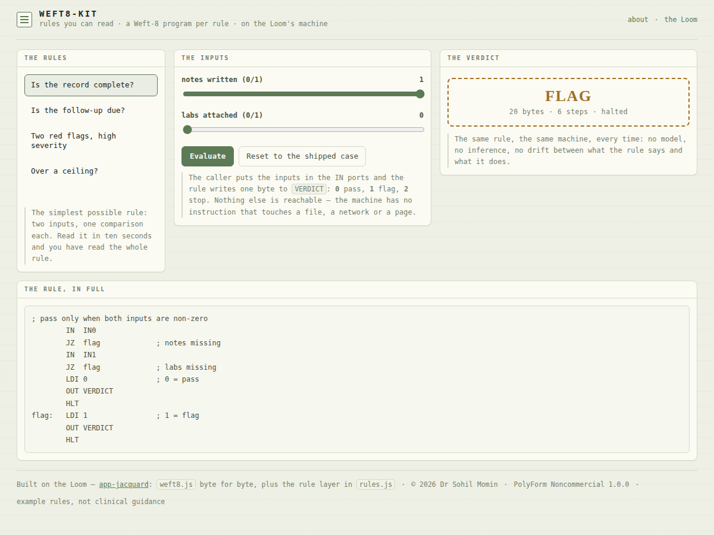

<div align="center">

# weft8-kit

<!-- shot:start -->



<!-- shot:end -->

**A rule engine small enough to sign off.**

[](https://drsamonline.github.io/weft8-kit/)
[](https://github.com/drsamonline/weft8-kit/actions/workflows/test.yml)
[](https://github.com/drsamonline/weft8-kit/actions/workflows/build-apps.yml)
[](LICENSE)
[-8c3b2e?style=flat-square&labelColor=22261d)](https://github.com/drsamonline/app-jacquard)
[](package.json)

[**Open the rule bench →**](https://drsamonline.github.io/weft8-kit/)

</div>


A rule is a **Weft-8 program with a contract**: the caller puts inputs in the ports, the rule writes one
byte to the verdict port, and everything else is the machine's business.

```
IN0 0xD0   IN1 0xD1   IN2 0xD2   IN3 0xD3      the inputs, 0-255
VERDICT 0xD7                                   0 pass · 1 flag · 2 stop
```

That is the whole interface. The same in the browser, in a test, and in any app that adopts the kit.

## Why a rule engine at all

Three properties a rules engine in a general-purpose language struggles to promise:

- **Readable** — a rule is twenty lines you can read aloud. No callbacks, no hidden state, no library
  deciding what "and" means.
- **Bounded** — 27 opcodes, none of which touch a file, a network or a page, and a step limit. A runaway
  rule stops and says so.
- **Provable** — every rule ships its cases and the test suite runs them on the real machine, including a
  case where the comparison is deliberately flipped to prove the test bites.

## The five example rules

| Rule | Question | What it shows |
|---|---|---|
| `record-complete` | are both fields filled in? | two inputs, one comparison each — the smallest possible rule |
| `follow-up-due` | has it been longer than the agreed interval? | a threshold that is an **input**, not a number baked into code |
| `two-red-flags` | two or more flags, and severity ≥ 7? | what an "and" costs when the machine has no `and` branch |
| `ceiling` | is the value above the ceiling you set? | the pattern a dose or budget check uses |
| `two-of-three` | are two of the three fields present? | counting is not an instruction — you add one per input and compare |

> These are **examples of the pattern, not clinical guidance.** The numbers in them are illustrations.

## Built on the Loom

`docs/play/weft8.js` is the **Weft-8** from [Jacquard (the Loom)](https://github.com/drsamonline/app-jacquard)
— byte for byte the same engine, the same one its 102 assertions cover. This kit adds one file on top:
`rules.js`, the port contract and the rule set.

## Adopt it

Copy two files into your app:

```html
<script src="weft8.js"></script>
<script src="rules.js"></script>
<script>
  var r = Rules.evaluate(Rules.ruleById("follow-up-due"), [45, 30]);
  // r.verdict === 1   r.word === "flag"   r.steps === 11
</script>
```

`Rules.evaluate(rule, values)` returns `{ verdict, word, steps, halted, error, bytes }` and never throws on
a bad rule — a rule that does not assemble comes back with `errors`.

## Test it

```
npm install
node test-node.js          # 99 assertions — the machine, every rule case, and the guarantees
node tests/page-smoke.js   # 9 assertions — the bench, driven in jsdom
```

The suite asserts every rule's own cases, that a runaway rule writes **no** verdict and stops at the step
limit, that **no opcode reaches the network, the filesystem or the DOM** (the opcode list *is* the
permission list), and that flipping a comparison or deleting a check makes the matching case fail.

## The limits, stated

- The machine compares **signed** bytes, so an input above 127 reads as negative. The `ceiling` rule says
  so in its own words, and a test pins that behaviour rather than hiding it.
- Four rules is a demonstration, not a library of clinical logic. Adopting the kit means writing and
  checking your own.


## The Weft-8 family

One machine, seven faces. Every one of these runs `weft8.js` from the Loom, byte for byte —
learn it once and you have learned all seven.

| | what it is |
|---|---|
| [the Loom](https://drsamonline.github.io/app-jacquard/) | the machine and its editor — where it all starts |
| [Weft Puzzles](https://drsamonline.github.io/app-weft-puzzles/) | five puzzles solved in assembly, a robot on a grid |
| [Clip Loom](https://drsamonline.github.io/app-clip-loom/) | clipboard programs you can read: strip, squeeze, wrap |
| [Weft-8 on hardware](https://drsamonline.github.io/weft8-hardware/) | the same machine in C, three-way parity with the JS one |
| **weft8-kit** (you are here) | rules small enough to sign off |
| [Weft-8 Classroom](https://drsamonline.github.io/weft8-classroom/) | eight exercises that teach how a computer works |
| [Weft-8 beside x86 and ARM](https://drsamonline.github.io/weft8-compare/) | the same four jobs in three machines |

<!-- support:sweep -->
## Support

One person's work: no company, no ads, no tracking, no paid tier. If it saved you an
afternoon, a contribution keeps the next one coming — any amount, or none.

| | |
|---|---|
| **UPI** | `drsohilboi@ybl` |
| **Ko-fi** | [ko-fi.com/matneo](https://ko-fi.com/matneo) |
| **PayPal** | [paypal.me/drsohilmomin](https://paypal.me/drsohilmomin?locale.x=en_GB&country.x=IN) |
| **Books** | [the author's other work](https://www.amazon.com/stores/author/B08ZT331LY/allbooks) |
| **Elsewhere** | [all projects](https://drsamonline.github.io/) |
| **Email** | [sohilmomin2000@gmail.com](mailto:sohilmomin2000@gmail.com) — bugs, corrections, requests |

## Licence

**PolyForm Noncommercial 1.0.0** · © 2026 Dr Sohil Momin. Free for any noncommercial purpose.
